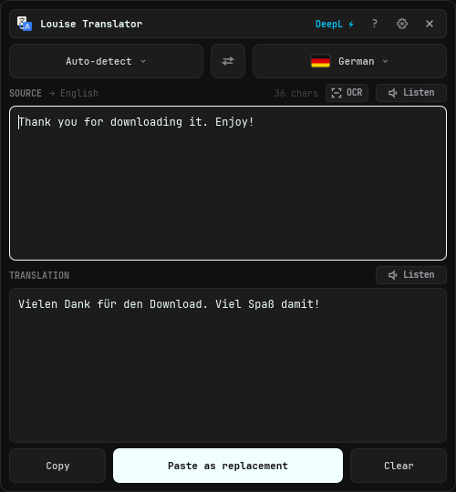
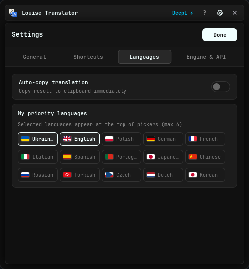

<div align="center">

<p align="center">
  
</p>

# 🌌 Louise (Dr. Louise Banks)
### Discreet, Keyboard-First Instant Desktop Translator for Windows

<p align="center">
  <a href="https://github.com/MarianQQQ/LouiseTranslator">
    
  </a>
</p>

[](https://www.rust-lang.org/)
[](https://slint.dev/)
[](https://microsoft.com)
[](https://www.deepl.com/)
[](https://learn.microsoft.com/en-us/uwp/api/windows.media.ocr)
[](LICENSE)

<br>

> *«Language is the first weapon drawn in a conflict... or the first hand extended in understanding.»*  
> — **Dr. Louise Banks**, *Arrival* (2016)

</div>

---

## 📸 Interface Showcase

<p align="center">
  
  &nbsp;&nbsp;
  
</p>
<p align="center">
  <i>Left: Main UI — Auto-detect, DeepL ⚡ badge, OCR button, inline TTS playback. Right: Engine & API settings with TTS provider selector.</i>
</p>

---

## ✨ Key Features

| | Feature |
|---|---|
| **⚡ Alt+C** | Highlight any text → instant translation appears next to cursor |
| **📷 Alt+S** | Freeze screen → drag to snip → OCR extracts & translates (100% offline, Windows Media OCR) |
| **🔊 TTS** | Neural voices via Edge TTS (29 langs) + Google TTS mutual fallback, switch in Settings |
| **🪟 Alt+X** | Toggle Louise window near cursor for manual input |
| **🔄 Replace** | Paste translated text directly back into any app with one click |
| **🧠 Dual-Engine** | DeepL for supported languages, auto-switches to Google for the rest — no setup needed |
| **🛡️ Fallback** | Auto-fallback on quota exhaustion, network errors, or unsupported language pairs |
| **🔒 Privacy** | Zero telemetry, DPAPI-encrypted keys, fully local `config.json` |
| **🚀 Native** | Rust + Slint — no Electron, ~60 MB RAM, sub-15ms start |

---

## 🧠 Dual-Engine Translation

<div align="center">

| | ⚡ DeepL API | 🌐 Google Translate |
| :--- | :--- | :--- |
| **Quality** | Neural AI, natural phrasing | Fast, reliable |
| **Setup** | Free or Pro API key | None — zero setup |
| **Auto-switch** | Used when language is supported | Fallback for the rest |
| **Badge** | `DeepL ⚡` | `Google` |

</div>

<details>
<summary><b>🔑 Free DeepL API Key setup</b></summary>
<br>

1. Register at [deepl.com/pro-api](https://www.deepl.com/pro-api) (Free: 500k chars/month).
2. Copy your **Authentication Key** (ends with `:fx`).
3. Open Louise → `⚙` Settings → **Engine & API** → paste key into DeepL card.

</details>

---

## 🔊 Neural Text-to-Speech

<div align="center">

| | 🎙️ Edge Neural TTS | 🔊 Google TTS |
| :--- | :--- | :--- |
| **Quality** | Natural Microsoft neural voices | Clear synthetic voices |
| **Languages** | 29 languages | All supported languages |
| **Fallback** | → Google on failure | → Edge on failure |

</div>

Switch providers: Settings → **Engine & API** → TTS section. Audio is synthesized with natural pacing (+3%) and cached per-provider for instant replay.

---

## 📷 Screen OCR — Windows Language Packs

Louise uses native **Windows.Media.Ocr** — offline, zero cloud tokens. Install OCR packs via PowerShell (as Administrator):

```powershell
# Install popular languages in one command:
@("uk-UA","en-US","pl-PL","de-DE","fr-FR","es-ES","it-IT","ja-JP") |
  ForEach-Object { Add-WindowsCapability -Online -Name "Language.OCR~~~$_~0.0.1.0" }
```

> **GUI alternative**: Win+I → Time & Language → Language & region → `...` → Language options → Download **OCR**.

---

## ⌨️ Shortcuts

<div align="center">

| Shortcut | Action |
| :---: | :--- |
| <kbd>Alt</kbd>+<kbd>C</kbd> | Translate selected text |
| <kbd>Alt</kbd>+<kbd>S</kbd> | Screen OCR snip |
| <kbd>Alt</kbd>+<kbd>X</kbd> | Toggle window |
| <kbd>Ctrl</kbd>+<kbd>Enter</kbd> | Translate typed input |
| <kbd>Escape</kbd> | Hide to tray / cancel snip |

</div>

All shortcuts are customizable in Settings → **Shortcuts** tab.

---

## 🚀 Quick Start

**Option 1 — Download**: Grab `Louise Translator.exe` from [Releases](https://github.com/MarianQQQ/LouiseTranslator/releases) and run it.

**Option 2 — Build from source**:
```powershell
git clone https://github.com/MarianQQQ/LouiseTranslator.git
cd LouiseTranslator
cargo build --release
```

---

## 📂 Configuration

`config.json` is stored locally next to the executable (never tracked by Git, keys encrypted via DPAPI):

```json
{
  "src_lang": "auto",
  "dst_lang": "uk",
  "priority_langs": ["uk", "en", "pl"],
  "use_deepl": true,
  "deepl_key": "YOUR_KEY_HERE:fx",
  "use_edge_tts": true,
  "autostart": true
}
```

---

<div align="center">

If Louise makes your multilingual workflow calmer and faster, consider giving the repo a ⭐!

[](https://github.com/MarianQQQ/LouiseTranslator/stargazers)

*Inspired by Denis Villeneuve's «Arrival» · Built with [Rust](https://www.rust-lang.org/) & [Slint](https://slint.dev/) · [MIT License](LICENSE) © 2026*

</div>
